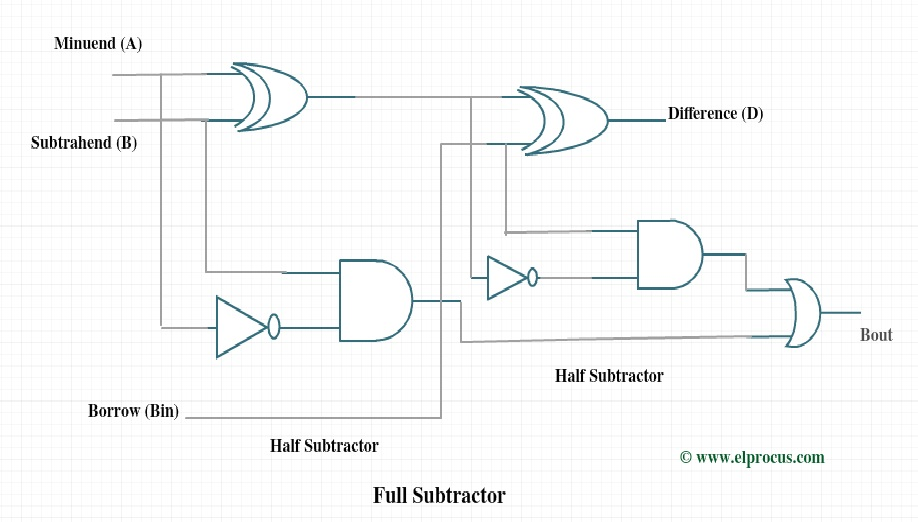
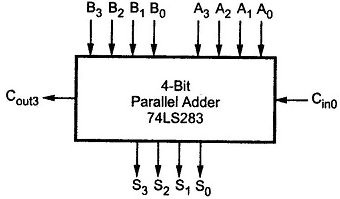
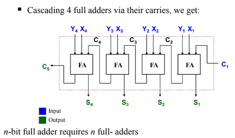
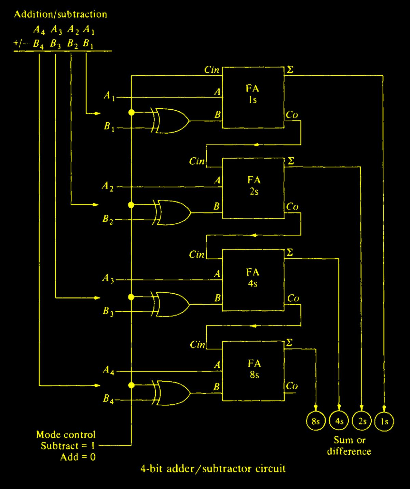

# Half adder

### Circuit Diagram

### Logical Diagram

#### Boolean Expression
$S = XY' + X'Y$\
$S = X \oplus Y$

$C = XY $

### Truth Table
| X | Y | S| C|
|:-:|:-:|:-:|:-:|
|0|0|0|0|
|0|1|0|1|
|1|0|0|1|
|1|1|1|0|

# Full adder

### Circuit Diagram

### Logical Diagram

#### Boolean Expression
$S = (X \oplus Y) \oplus Z$
 
$C = XY + (X \oplus Y) \cdot Z$

### Truth Table
| X | Y |  z/Cin | S | Cout |
|:-:|:-:|:-:|:-:|:-:|
| 0 | 0 | 0 | 0 | 0 |
| 0 | 0 | 1 | 1 | 0 |
| 0 | 1 | 0 | 1 | 0 |
| 0 | 1 | 1 | 0 | 1 |
| 1 | 0 | 0 | 1 | 0 |
| 1 | 0 | 1 | 0 | 1 |
| 1 | 1 | 0 | 0 | 1 |
| 1 | 1 | 1 | 1 | 1 |

## Design Procedure of Full Adder

> - Half adders add only upto 2 bits. To add two binary numbers, we need to add 3 bits, including the carry.    
> - Z/Cin = Carry in, C = Carry out

### **Kmap for S**
| | y'Cin'(00) |y'Cin(01) |yCin(11) |yCin'(10) |
|:-: |:-:|:-:|:-:|:-:|
x'(0) | |1| | 1|
x(1)  |1| |1|  | 

#### Boolean Expression :

$C = X'Y'Cin + X'YCin' +XY'Cin'  + XYCin$\
$= Cin(X'Y' + XY) + Cin'(X'Y+XY')$\
$= Cin(X \oplus Y)' + Cin'(X \oplus Y)$\
$=X \oplus Y \oplus Cin$

### **Kmap for C**
| | y'Cin'(00) |y'Cin(01) |yCin(11) |yCin'(10) |
| :-: |:-:|:-:|:-:|:-:|
|x'(0) | | |1| |
|x(1)  | |1|1|1| 

#### Boolean Expression :

$C = XCin + YCin + XY$

# Half Subtractor

### Circuit Diagram

### Logical Diagram

#### Boolean Expression
$D = X \oplus Y$  
$B = X' \cdot Y$

### Truth Table
| A | B | Difference (D) | Borrow (Bo) |
|:-:|:-:|:-:|:-:|
| 0 | 0 | 0 | 0 |
| 0 | 1 | 1 | 1 |
| 1 | 0 | 1 | 0 |
| 1 | 1 | 0 | 0 |

# Full Subtractor
 
### Circuit Diagram

### Logical Diagram
 

#### Boolean Expression
$D = A \oplus ( B \oplus Bin )$  
$Bout = (A \cdot (B \oplus Bin)' ) + B' \cdot Bin$

### Truth Table
| A | B | Bin | Difference (D) | Borrow-out (Bout) |
|:-:|:-:|:-:|:-:|:-:|
| 0 | 0 | 0 | 0 | 0 |
| 0 | 0 | 1 | 1 | 1 |
| 0 | 1 | 0 | 1 | 1 |
| 0 | 1 | 1 | 0 | 1 |
| 1 | 0 | 0 | 1 | 0 |
| 1 | 0 | 1 | 0 | 0 |
| 1 | 1 | 0 | 0 | 0 |
| 1 | 1 | 1 | 1 | 1 |

## Design Precedure of Full Subtractor from Full adder

### Difference between full adder and subtractor
|Full Adder	|Full Subtractor|
|:-:|:-:|
|Inputs: A, B, Cin |	Inputs: A, B, Bin|
|Sum (S)	|Difference (D) |
|Carry (Cout) |	Borrow (Bout) |

### **Kmap for D**
| | B' Bin'(00) |B' Bin(01) |B Bin(11) |B Bin'(10) |
|:-: |:-:|:-:|:-:|:-:|
A'(0) | |1| | 1|
A(1)  |1| |1|  |

#### Boolean Expression
$D = A'B' Bin + A'B Bin' + AB' Bin' + AB Bin$\
$D = A \oplus B \oplus Bin$

### **Kmap for Bout**
| | B' Bin'(00) |B' Bin(01) |B Bin(11) |B Bin'(10) |
|:-: |:-:|:-:|:-:|:-:|
A'(0) | |1|1| 1|
A(1)  | | |1|  |

#### Boolean Expression
$Bout = A' Bin + A' B + B Bin$

# 4-bit parallel adder

### Circuit Diagram

### Full adder to 4 bit parallel adder

### Logical Diagram

### Truth Table