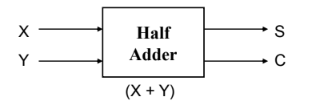
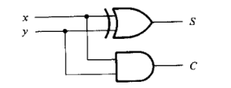
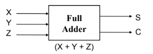
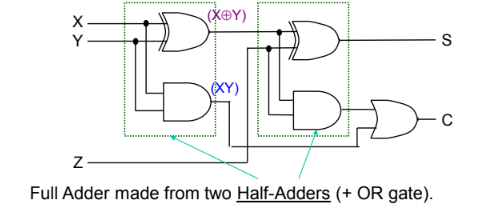
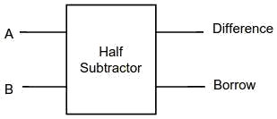
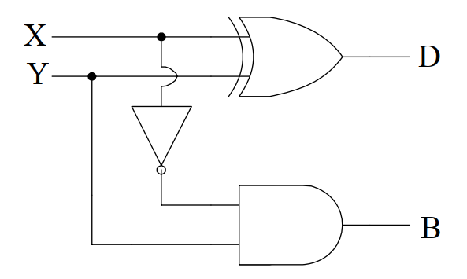
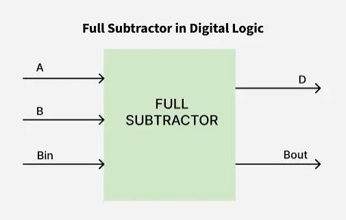
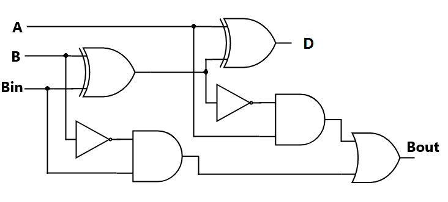

# Half adder

### Circuit Diagram


### Truth Table
| X | Y | S| C|
|:-:|:-:|:-:|:-:|
|0|0|0|0|
|0|1|0|1|
|1|0|0|1|
|1|1|1|0|

### Logical Diagram


#### Boolean Expression
$S = XY' + X'Y$\
$S = X \oplus Y$

$C = XY $


# Full adder

### Circuit Diagram



### Truth Table
| X | Y | Z/ Cᵢₙ | S | Cₒᵤₜ |
|:-:|:-:|:-:|:-:|:-:|
| 0 | 0 | 0 | 0 | 0 |
| 0 | 0 | 1 | 1 | 0 |
| 0 | 1 | 0 | 1 | 0 |
| 0 | 1 | 1 | 0 | 1 |
| 1 | 0 | 0 | 1 | 0 |
| 1 | 0 | 1 | 0 | 1 |
| 1 | 1 | 0 | 0 | 1 |
| 1 | 1 | 1 | 1 | 1 |

### Logical Diagram


#### Boolean Expression
$S = (X \oplus Y) \oplus Z$
 
$C = XY + (X \oplus Y) \cdot Z$


## Design Procedure of Full Adder

> - Half adders add only upto 2 bits. To add two binary numbers, we need to add 3 bits, including the carry.    
> - Z = Carry in, C = Carry out

#### **Kmap for S**
| | y'z'(00) |y'z(01) |yz(11) |yz'(10) |
|:-: |:-:|:-:|:-:|:-:|
x'(0) | |1| | 1|
x(1)  |1| |1|  | 

#### Boolean Expression :


$C = XZ + YZ + XY$\
$= XY + (X+Y)Z$\
$= XY + ((X \oplus Y) + XY)Z$\
$= XY + (X \oplus Y)Z + XYZ$ \
$= XY + (X \oplus Y)Z$


#### **Kmap for C**
| | y'z'(00) |y'z(01) |yz(11) |yz'(10) |
| :-: |:-:|:-:|:-:|:-:|
|x'(0) | | |1| |
|x(1)  | |1|1|1| 

#### Boolean Expression :

$C = XZ + YZ + XY$ \
$= XY + (X+Y)Z$  \
$= XY + ((X \oplus Y) + XY)Z$ \
$= XY + (X \oplus Y)Z + XYZ$ \
$= XY + (X \oplus Y)Z $


# Half Subtractor

### Circuit Diagram


### Truth Table
| A | B | Difference (D) | Borrow (Bo) |
|:-:|:-:|:-:|:-:|
| 0 | 0 | 0 | 0 |
| 0 | 1 | 1 | 1 |
| 1 | 0 | 1 | 0 |
| 1 | 1 | 0 | 0 |


### Logical Diagram


#### Boolean Expression
$D = X \oplus Y$  
$B = X' \cdot Y$


# Full Subtractor
 
### Circuit Diagram



### Truth Table
| A | B | Bin | Difference (D) | Borrow-out (Bout) |
|:-:|:-:|:-:|:-:|:-:|
| 0 | 0 | 0 | 0 | 0 |
| 0 | 0 | 1 | 1 | 1 |
| 0 | 1 | 0 | 1 | 1 |
| 0 | 1 | 1 | 0 | 1 |
| 1 | 0 | 0 | 1 | 0 |
| 1 | 0 | 1 | 0 | 0 |
| 1 | 1 | 0 | 0 | 0 |
| 1 | 1 | 1 | 1 | 1 |

### Logical Diagram
 

#### Boolean Expression
$D = A \oplus B \oplus Bin$  
$Bout = A'B + A'Bin + BBin$

>```md
> # Design Precedure of Full Subtractor
>```


