# Half adder

### Circuit Diagram
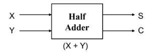

### Logical Diagram

#### Boolean Expression
$S = XY' + X'Y$\
$S = X \oplus Y$

$C = XY $

### Truth Table
| X | Y | S| C|
|:-:|:-:|:-:|:-:|
|0|0|0|0|
|0|1|0|1|
|1|0|0|1|
|1|1|1|0|

# Full adder

### Circuit Diagram
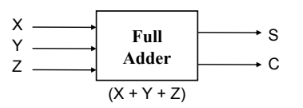

### Logical Diagram

#### Boolean Expression
$S = (X \oplus Y) \oplus Z$
 
$C = XY + (X \oplus Y) \cdot Z$

### Truth Table
| X | Y |  z/Cin | S | Cout |
|:-:|:-:|:-:|:-:|:-:|
| 0 | 0 | 0 | 0 | 0 |
| 0 | 0 | 1 | 1 | 0 |
| 0 | 1 | 0 | 1 | 0 |
| 0 | 1 | 1 | 0 | 1 |
| 1 | 0 | 0 | 1 | 0 |
| 1 | 0 | 1 | 0 | 1 |
| 1 | 1 | 0 | 0 | 1 |
| 1 | 1 | 1 | 1 | 1 |

## Design Procedure of Full Adder from half adder

> - Half adders add only upto 2 bits. To add two binary numbers, we need to add 3 bits, including the carry.    
> - Z/Cin = Carry in, C = Carry out

| Half adder | Full adder |
|:-:|:-:|
| Inputs: A, B | Inputs: A, B, Cin|
| S ,Cout| S, Cout|

### Make the Truth table of Full adder and then use Kmap

| X | Y |  z/Cin | S | Cout |
|:-:|:-:|:-:|:-:|:-:|
| 0 | 0 | 0 | 0 | 0 |
| 0 | 0 | 1 | 1 | 0 |
| 0 | 1 | 0 | 1 | 0 |
| 0 | 1 | 1 | 0 | 1 |
| 1 | 0 | 0 | 1 | 0 |
| 1 | 0 | 1 | 0 | 1 |
| 1 | 1 | 0 | 0 | 1 |
| 1 | 1 | 1 | 1 | 1 |

### Kmap for Sum from the truth table

| | y'z' | y'z | yz | yz' |
|:-:|:-:|:-:|:-:|:-:|
|x'|  | 1 | | 1| 
|x | 1| | 1| |

### Kmap for Cout from the truth table

| | y'z' | y'z | yz | yz' |
|:-:|:-:|:-:|:-:|:-:|
|x'|  |  | 1| | 
|x | | 1| 1| 1|

### Full Adder
#### Boolean Expression :

$S=XY'Z' + X'Y'Z + XYZ+ X'YZ'$\
$S= Z(X'Y' + XY) + Z'(XY' + X'Y)$\
$S=Z(X\oplus Y)' + Z'(X \oplus Y )$\
$S=X \oplus Y \oplus Cin$

$C = XCin + YCin + XY$

# Half Subtractor

### Circuit Diagram

### Logical Diagram

#### Boolean Expression
$D = X \oplus Y$  
$B = X' \cdot Y$

### Truth Table
| A | B | Difference (D) | Borrow (Bo) |
|:-:|:-:|:-:|:-:|
| 0 | 0 | 0 | 0 |
| 0 | 1 | 1 | 1 |
| 1 | 0 | 1 | 0 |
| 1 | 1 | 0 | 0 |

# Full Subtractor
 
### Circuit Diagram

### Logical Diagram
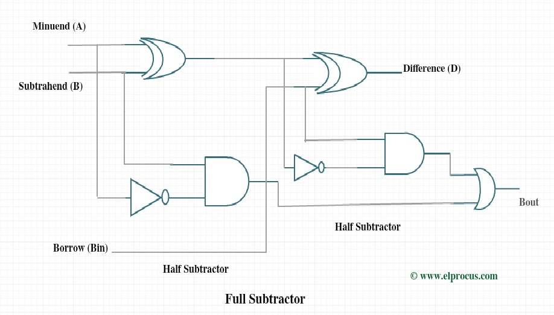 

#### Boolean Expression
$D = A \oplus B \oplus Bin $  
$Bout = (Bin \cdot (A \oplus B)' ) + A' \cdot B$

### Truth Table
| A | B | Bin | Difference (D) | Borrow-out (Bout) |
|:-:|:-:|:-:|:-:|:-:|
| 0 | 0 | 0 | 0 | 0 |
| 0 | 0 | 1 | 1 | 1 |
| 0 | 1 | 0 | 1 | 1 |
| 0 | 1 | 1 | 0 | 1 |
| 1 | 0 | 0 | 1 | 0 |
| 1 | 0 | 1 | 0 | 0 |
| 1 | 1 | 0 | 0 | 0 |
| 1 | 1 | 1 | 1 | 1 |

# Design Procedure of Full Subtractor using Full adder

### Difference between full adder and subtractor
|Full Adder	|Full Subtractor|
|:-:|:-:|
|Inputs: A, B, Cin |	Inputs: A, B, Bin|
|Sum (S)	|Difference (D) |
|Carry (Cout) |	Borrow (Bout) |

### Full Subtractor
#### Boolean Expression

$D = A \oplus B \oplus Bin$\
$Bout = A'B + A' Bin + B Bin$

### Full Adder
#### Boolean Expression

$S = X \oplus Y \oplus Cin$\
$Cout = XY + X Cin + YCin$

### Circuit Diagram of Full adder, point out the half adders and the OR gate
---

#### To implement subtraction using addition, use 2's complement:

$ A-B-Bin = A +B' + Bin' $

#### Therefore, comparing Full Adder inputs and outputs with Full Subtractor
$X=A$\
$Y=B'$\
$Cin = Bin'$\
$S=D$\
$Cout = Bout'$

### Circuit diagram with examples

### Examples (using $X=A,\ Y=B',\ Cin=Bin',\ D=S,\ Bout=Cout'$)

| A | B | Bin | X | Y = B' | Cin = Bin' | S | Cout | D = S | Bout = Cout' | Matches truth table |
|:-:|:-:|:-:|:-:|:-:|:-:|:-:|:-:|:-:|:-:|:-:|
| 0 | 1 | 0 | 0 | 0 | 1 | 1 | 0 | 1 | 1 | ✓ |
| 1 | 0 | 0 | 1 | 1 | 1 | 1 | 1 | 1 | 0 | ✓ |
| 0 | 1 | 1 | 0 | 0 | 0 | 0 | 0 | 0 | 1 | ✓ |

# 4-bit parallel adder

### Circuit Diagram

### Full adder to 4 bit parallel adder
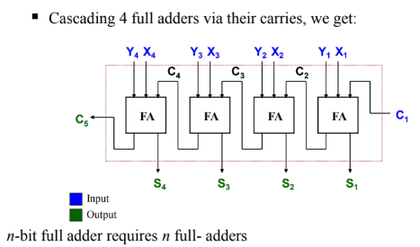

### Logical Diagram

### Truth Table

- Truth table for 9 inputs is very big, i.e. $2^9$=512 entries:

| $X_4\ X_3\ X_2\ X_1$ | $Y_4\ Y_3\ Y_2\ Y_1$ | $C_1$ | $C_5$ | $S_4\ S_3\ S_2\ S_1$ |
| :---: | :---: | :---: | :---: | :---: |
| 0 0 0 0 | 0 0 0 0 | 0 | 0 | 0 0 0 0 |
| 0 0 0 0 | 0 0 0 0 | 1 | 0 | 0 0 0 1 |
| 0 0 0 0 | 0 0 0 1 | 0 | 0 | 0 0 0 1 |
| $\vdots$ | $\vdots$ | $\vdots$ | $\vdots$ | $\vdots$ |
| 0 1 0 1 | 1 1 0 1 | 1 | 1 | 0 0 1 1 |
| $\vdots$ | $\vdots$ | $\vdots$ | $\vdots$ | $\vdots$ |
| 1 1 1 1 | 1 1 1 1 | 1 | 1 | 1 1 1 1 |

### Examples
**1) $0011 + 0111$, $C_1 = 0$** (3 + 7)

| | $C_5$ | $C_4$ | $C_3$ | $C_2$ | $C_1$ |
|:-:|:-:|:-:|:-:|:-:|:-:|
| carry | 0 | 1 | 1 | 1 | 0 |

| | $X_4$ | $X_3$ | $X_2$ | $X_1$ |
|:-:|:-:|:-:|:-:|:-:|
| X | 0 | 0 | 1 | 1 |
| Y | 0 | 1 | 1 | 1 |
| S | 1 | 0 | 1 | 0 |

$S = 1010_2 = 10$, $C_5 = 0$

**2) Largest result:** $1111 + 1111 + 1 = 11111$ → $C_5 = 1$, $S = 1111$ (this is why 5 output bits are enough)

**3) $1001 + 1000$, $C_1 = 0$** (9 + 8) → $C_5 = 1$, $S = 0001$ → $10001_2 = 17$

# 4-bit parallel adder cum Subtractor

### Circuit Diagram
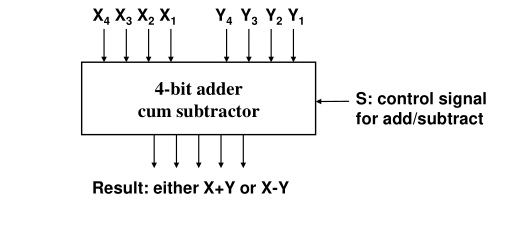

### Logical Diagram
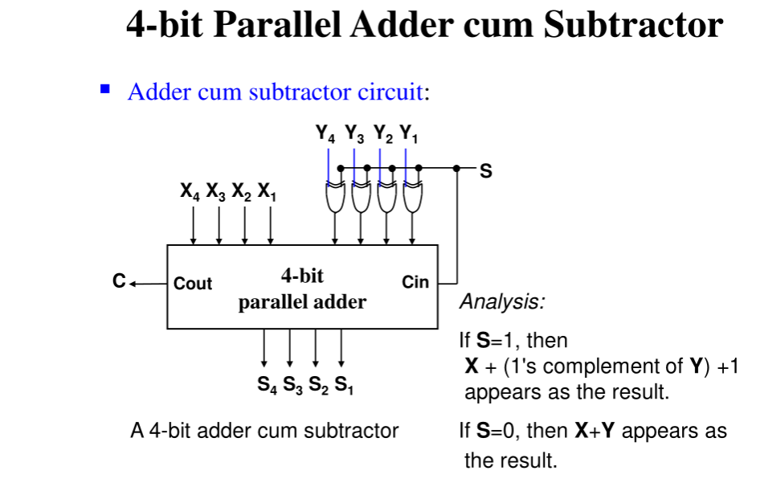

### Examples
Control $S=0$: add, $S=1$: subtract ($Y$ goes through XOR with $S$, and $S$ is also $C_1$)

| S | X | Y | Y ⊕ S | X + (Y ⊕ S) + S | $C_5$ | Result | Meaning |
|:-:|:-:|:-:|:-:|:-:|:-:|:-:|:-:|
| 0 | 0101 | 0110 | 0110 | 0101 + 0110 + 0 = 01011 | 0 | 1011 | 5 + 6 = 11 |
| 1 | 0111 | 0011 | 1100 | 0111 + 1100 + 1 = 10100 | 1 | 0100 | 7 − 3 = 4 (positive, no borrow) |
| 1 | 0011 | 0111 | 1000 | 0011 + 1000 + 1 = 01100 | 0 | 1100 | 3 − 7 = −4 (negative, result is in 2's complement) |

# Cascading Adder
- cascade means connecting multiple circuits in a sequence, where output of one circuit becomes input of next circuit

# 9 bit parallel adder
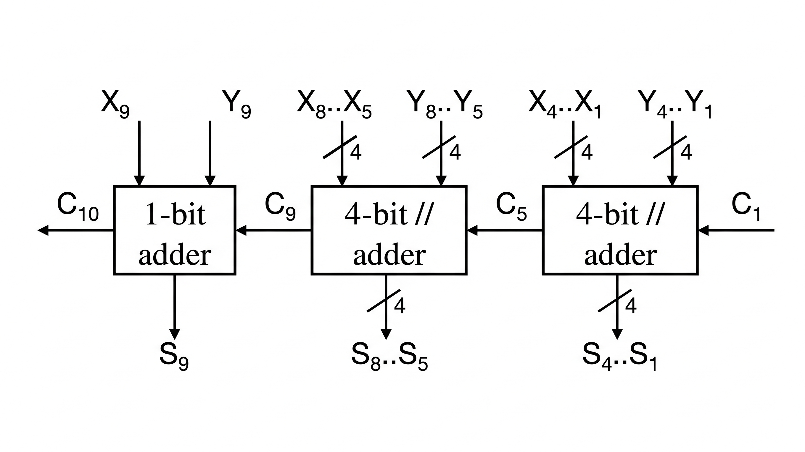

# 16/12/8 bit parallel adder,
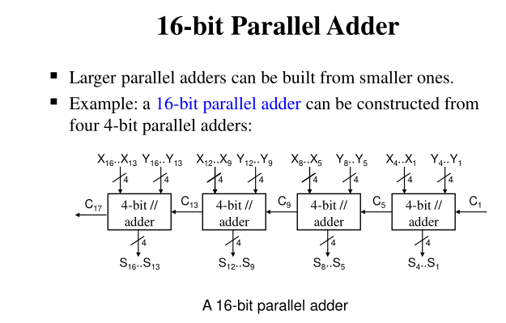

# Voting System 6 person 
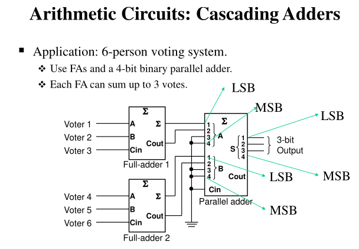

- Full adder has 3 inputs and 2 outputs
- Parallel adder has 3 input junctions, 2 junctions with 4 inputs and one junction with one input.
- Connected one FA to one juntion. The A junction got connected with 2 outputs from FA, other inputs go to ground as they are unused, same for B junction. As 3rd junction (Cin) is not used, it goes to ground too.
- Only 2 inputs for each junctions, total 4 inputs used in PA, always

### Examples
**6 voters**, votes $V_1..V_6 = 1,1,0,1,1,1$
- FA1 ($1,1,0$): $S=0$, $C_{out}=1$ → $A = 0010$
- FA2 ($1,1,1$): $S=1$, $C_{out}=1$ → $B = 0011$
- Parallel adder: $0010 + 0011 = 0101$ → output $S_3S_2S_1 = 101$ = 5 votes

**12 voters**, all vote 1
- Each FA ($1,1,1$) gives $S=1$, $C_{out}=1$ → $0011$
- Each parallel adder: $0011 + 0011 = 0110$ (6 votes)
- Final parallel adder: $0110 + 0110 = 1100$ = 12 votes (4-bit output, $S_4$ is needed)

# Voting System 8 person 

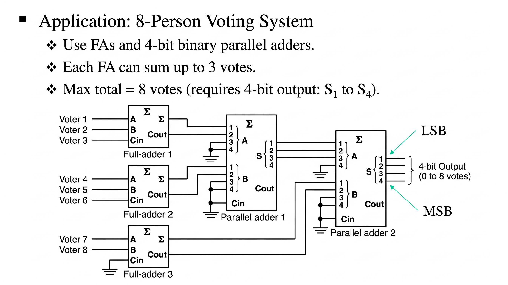
- Only 2 inputs for each juntions, total 4 inputs used in PA, always

# Voting System 9 person 

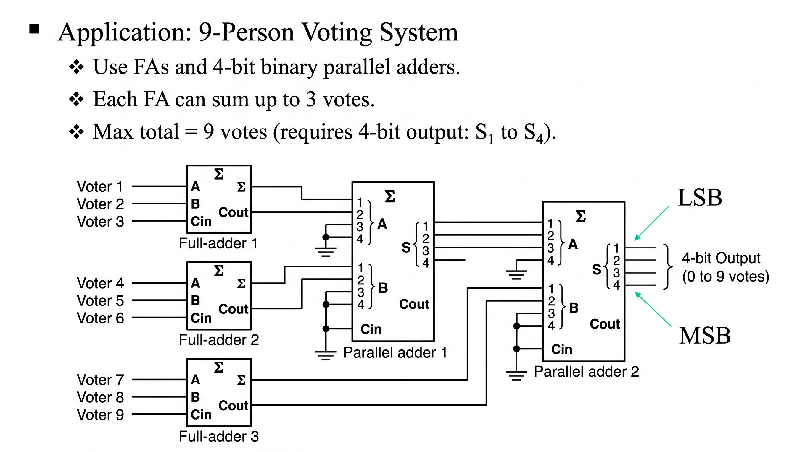
- Only 2 inputs for each juntions, total 4 inputs used in PA, always

# Voting System 12 person 

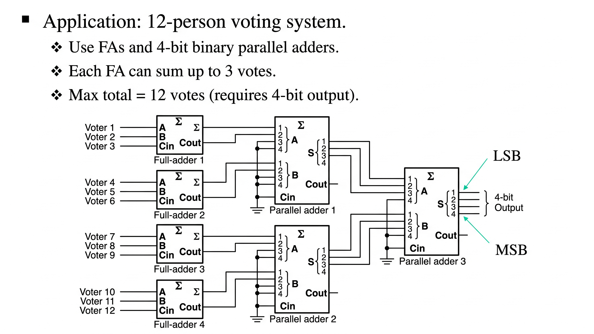

- Only 2 inputs for each juntions, total 4 inputs used in PA, always

# BCD to excess 3 code converter using 4-bit Parallel adder

- Code converter: takes an input code and translates it to its equivalent output code
- Excess-3 code = BCD + 3, so the conversion is just adding $0011$ to the BCD digit using a 4-bit parallel adder

### Circuit Diagram
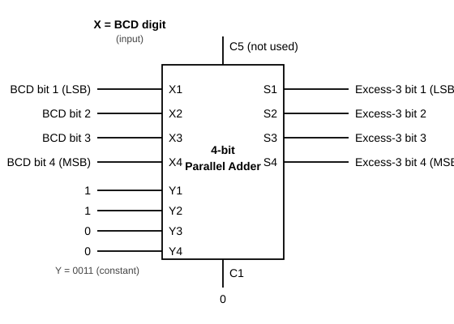

- $X_4X_3X_2X_1$ = BCD digit ($X_1$ is LSB)
- $Y_4Y_3Y_2Y_1 = 0011$ (constant): $Y_1 = 1,\ Y_2 = 1,\ Y_3 = 0,\ Y_4 = 0$
- $C_1 = 0$ (grounded)
- $S_4S_3S_2S_1$ = Excess-3 output ($S_1$ is LSB)
- $C_5$ is not used (a BCD digit is at most $1001$, so $1001 + 0011 = 1100$ never overflows)

### Truth Table
| Decimal | BCD ($X_4X_3X_2X_1$) | Excess-3 ($S_4S_3S_2S_1$) |
|:-:|:-:|:-:|
| 0 | 0000 | 0011 |
| 1 | 0001 | 0100 |
| 2 | 0010 | 0101 |
| 3 | 0011 | 0110 |
| 4 | 0100 | 0111 |
| 5 | 0101 | 1000 |
| 6 | 0110 | 1001 |
| 7 | 0111 | 1010 |
| 8 | 1000 | 1011 |
| 9 | 1001 | 1100 |

BCD inputs $1010$ to $1111$ never occur (don't care).

### Examples
- BCD $0110$ (6): $0110 + 0011 = 1001$ → excess-3 of 6
- BCD $1001$ (9): $1001 + 0011 = 1100$ → excess-3 of 9
- BCD $0000$ (0): $0000 + 0011 = 0011$ → excess-3 of 0

# Lecture-7, Page-36
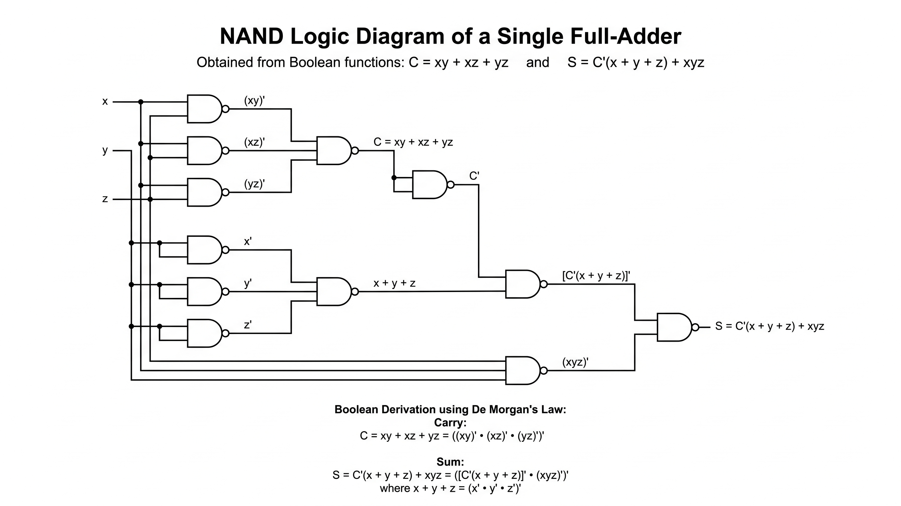
- Use NAND gate to make the logical diagram using given equations