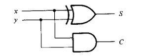
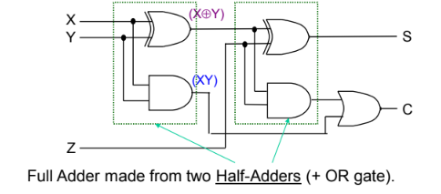
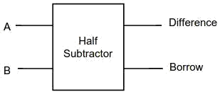
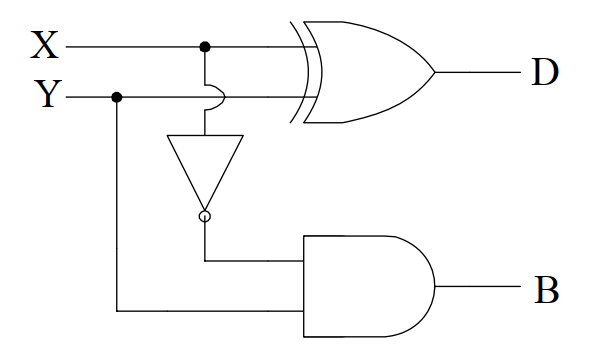
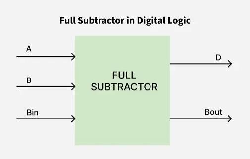
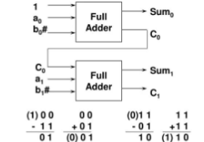
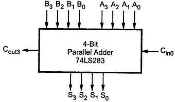
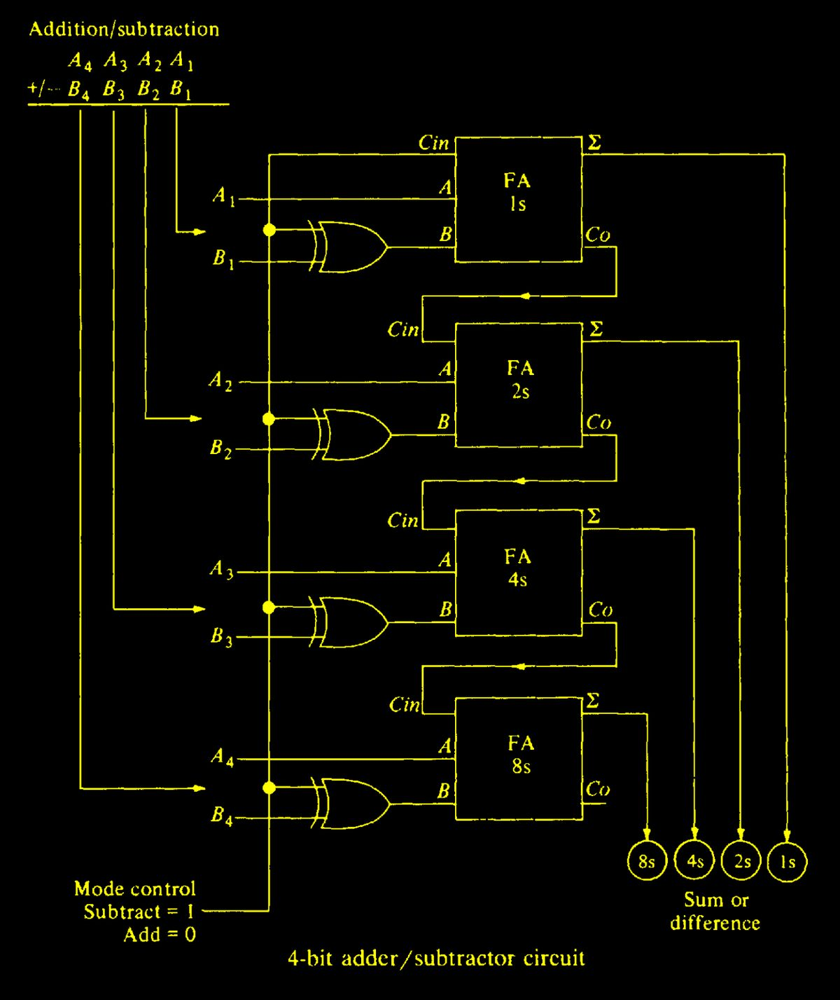

# Half adder

### Circuit Diagram

### Logical Diagram

#### Boolean Expression
$S = XY' + X'Y$\
$S = X \oplus Y$

$C = XY $

### Truth Table
| X | Y | S| C|
|:-:|:-:|:-:|:-:|
|0|0|0|0|
|0|1|0|1|
|1|0|0|1|
|1|1|1|0|

# Full adder

### Circuit Diagram

### Logical Diagram

#### Boolean Expression
$S = (X \oplus Y) \oplus Z$
 
$C = XY + (X \oplus Y) \cdot Z$

### Truth Table
| X | Y |  z/Cin | S | Cout |
|:-:|:-:|:-:|:-:|:-:|
| 0 | 0 | 0 | 0 | 0 |
| 0 | 0 | 1 | 1 | 0 |
| 0 | 1 | 0 | 1 | 0 |
| 0 | 1 | 1 | 0 | 1 |
| 1 | 0 | 0 | 1 | 0 |
| 1 | 0 | 1 | 0 | 1 |
| 1 | 1 | 0 | 0 | 1 |
| 1 | 1 | 1 | 1 | 1 |

## Design Procedure of Full Adder from half adder

> - Half adders add only upto 2 bits. To add two binary numbers, we need to add 3 bits, including the carry.    
> - Z/Cin = Carry in, C = Carry out

| Half adder | Full adder |
|:-:|:-:|
| Inputs: A, B | Inputs: A, B, Cin|
| S ,Cout| S, Cout|

### Half Adder
#### Boolean Expression
$S = XY' + X'Y$\
$C = XY $

### Full Adder
#### Boolean Expression :

$S=X \oplus Y \oplus Cin$\
$C = XCin + YCin + XY$

# Half Subtractor

### Circuit Diagram

### Logical Diagram

#### Boolean Expression
$D = X \oplus Y$  
$B = X' \cdot Y$

### Truth Table
| A | B | Difference (D) | Borrow (Bo) |
|:-:|:-:|:-:|:-:|
| 0 | 0 | 0 | 0 |
| 0 | 1 | 1 | 1 |
| 1 | 0 | 1 | 0 |
| 1 | 1 | 0 | 0 |

# Full Subtractor
 
### Circuit Diagram

### Logical Diagram
 

#### Boolean Expression
$D = A \oplus ( B \oplus Bin )$  
$Bout = (A \cdot (B \oplus Bin)' ) + B' \cdot Bin$

### Truth Table
| A | B | Bin | Difference (D) | Borrow-out (Bout) |
|:-:|:-:|:-:|:-:|:-:|
| 0 | 0 | 0 | 0 | 0 |
| 0 | 0 | 1 | 1 | 1 |
| 0 | 1 | 0 | 1 | 1 |
| 0 | 1 | 1 | 0 | 1 |
| 1 | 0 | 0 | 1 | 0 |
| 1 | 0 | 1 | 0 | 0 |
| 1 | 1 | 0 | 0 | 0 |
| 1 | 1 | 1 | 1 | 1 |

## Design Procedure of Full Subtractor using Full adder

### Difference between full adder and subtractor
|Full Adder	|Full Subtractor|
|:-:|:-:|
|Inputs: A, B, Cin |	Inputs: A, B, Bin|
|Sum (S)	|Difference (D) |
|Carry (Cout) |	Borrow (Bout) |

### Full Subtractor
#### Boolean Expression

$D = A \oplus B \oplus Bin$\
$Bout = A'B + A' Bin + B Bin$

### Full Adder
#### Boolean Expression

$S = X \oplus Y \oplus Cin$\
$Cout = XY + X Cin + YCin$

### Circuit Diagram of Full adder, point out the half adders and the OR gate
---

#### To implement subtraction using addition, use 2's complement:

$ A-B-Bin = A +B' + Bin' $

#### Therefore, comparing Full Adder inputs and outputs with Full Subtractor
$X=A$\
$Y=B'$\
$Cin = Bin'$\
$S=D$\
$Cout = Bout'$

### Circuit diagram with examples

# 4-bit parallel adder

### Circuit Diagram

### Full adder to 4 bit parallel adder

### Logical Diagram

### Truth Table

## 9 bit parallel adder, using 4 bit parallel adder and full adders connected in cascade

- cascade means connecting multiple circuits in a sequence, where output of one circuit becomes input of next circuit

#### Components
1. Two 4-bit parallel adders
2. One full adder