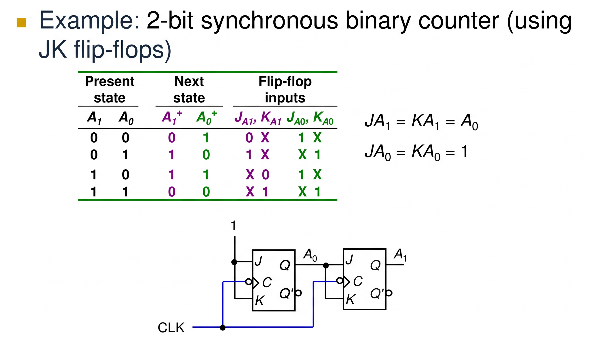
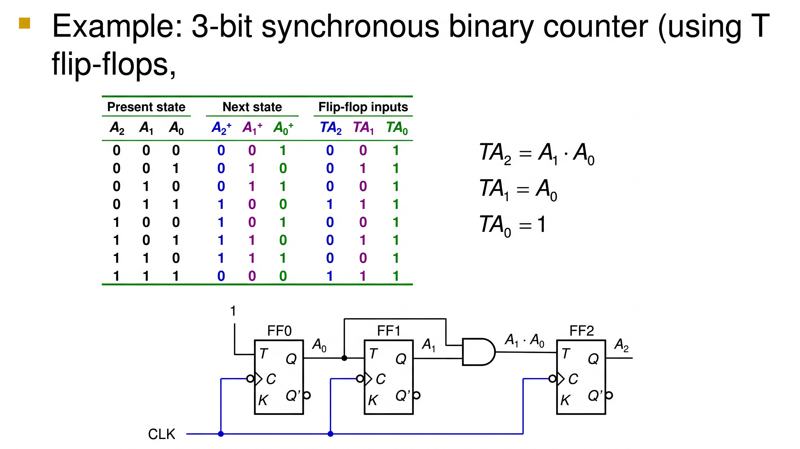
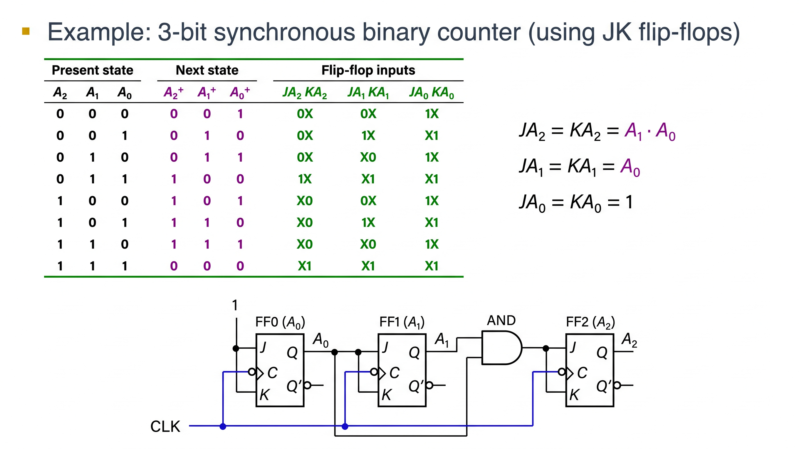

# From Lecture-11, page-34

# Synchronous (parallel ) counter

- A synchronous counter is a digital counter in which all flip-flops receive the same clock signal and change their states at the same time (synchronously).

- It is also called a parallel counter because the clock signal is supplied to all flip-flops in parallel rather than passing from one flip-flop to another

# Asynchrounous ( ripple ) counter

