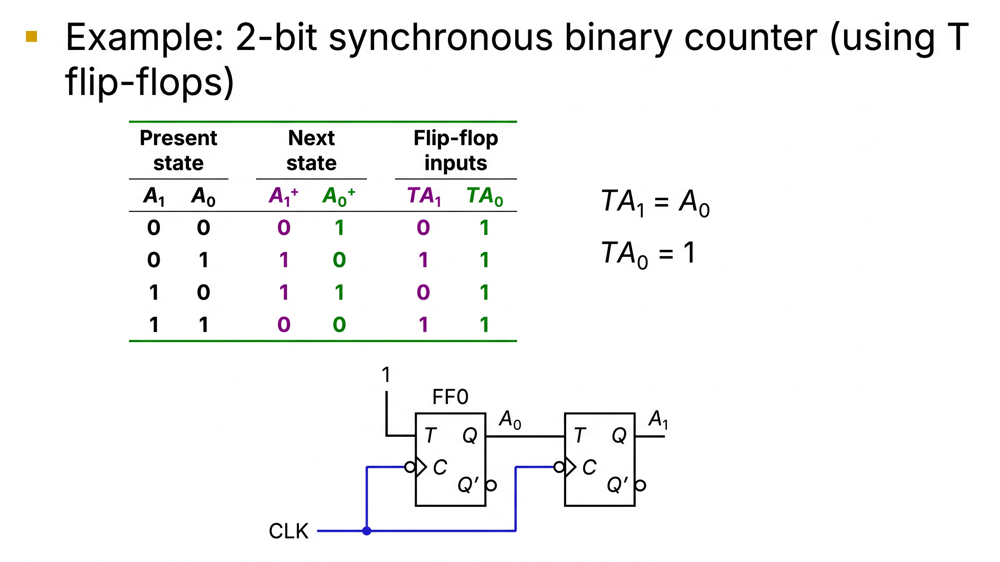

# From Lecture-11, page-34

# Synchronous (parallel ) counter

- A synchronous counter is a digital counter in which all flip-flops receive the same clock signal and change their states at the same time (synchronously).

- It is also called a parallel counter because the clock signal is supplied to all flip-flops in parallel rather than passing from one flip-flop to another

# Asynchrounous ( ripple ) counter

# Lec-11, Page-50

## Traffic Light Counter using D Flip-Flops (`Green -> Yellow -> Red -> Yellow -> Green`)

## 1. State Assignment

- **Green** = `00`
- **Yellow** = `01`
- **Red** = `10`
- **Unused State** = `11` (Don't-care `X`)

## 2. State Transition & D Flip-Flop Truth Table

For a D flip-flop, $D = Q^+$.

| Current State | Present `A` | Present `B` | Next State     | Next `A+` | Next `B+` | `DA` | `DB` |
| :-----------: | :---------: | :---------: | :------------- | :-------: | :-------: | :--: | :--: |
|   **Green**   |     `0`     |     `0`     | **Yellow**     |    `0`    |    `1`    | `0`  | `1`  |
|  **Yellow**   |     `0`     |     `1`     | **Red**        |    `1`    |    `0`    | `1`  | `0`  |
|    **Red**    |     `1`     |     `0`     | **Yellow**     |    `0`    |    `1`    | `0`  | `1`  |
|  **Unused**   |     `1`     |     `1`     | **Don't Care** |    `X`    |    `X`    | `X`  | `X`  |

## 3. 2-Variable Karnaugh Maps

### K-Map for `DA` (`= A+`)

|   `A \ B`    | `0 / B'` | `1 / B` |
| :----------: | :------: | :-----: |
| **`0 / A'`** |   `0`    |   `1`   |
| **`1 / A`**  |   `0`    |   `X`   |

- Grouping `(A=0, B=1)` with don't-care `(A=1, B=1)` gives:
  $$D_A = B$$

### K-Map for `DB` (`= B+`)

|   `A \ B`    | `0 / B'` | `1 / B` |
| :----------: | :------: | :-----: |
| **`0 / A'`** |   `1`    |   `0`   |
| **`1 / A`**  |   `1`    |   `X`   |

- Grouping `B=0` (`(A=0, B=0)` and `(A=1, B=0)`) gives:
  $$D_B = \overline{B}$$

# Prime Counter using T Flip-Flops (`1 -> 2 -> 3 -> 5 -> 7 -> 11 -> 13 -> 1`)

## 1. Bit Width & State Assignment

- Highest state is **13** (`1101` in binary), so **4 T flip-flops** (`A3, A2, A1, A0`) are required[cite: 2, 4].
- **Used States:** `1 (0001)`, `2 (0010)`, `3 (0011)`, `5 (0101)`, `7 (0111)`, `11 (1011)`, `13 (1101)`[cite: 4].
- **Unused States:** `0, 4, 6, 8, 9, 10, 12, 14, 15` — routed to **`0001` (`1`)** so the counter always self-corrects into the valid sequence[cite: 2] _(note: if your class treats unused states as don't-cares `X`, replace those rows with `X`)_.

## 2. State Transition & T Flip-Flop Excitation Table

For a T flip-flop, $T = Q \oplus Q^+$ (`0` if state stays the same, `1` if state toggles):

|   Dec    | Present State (`A3 A2 A1 A0`) | Next State (`A3+ A2+ A1+ A0+`) |  `TA3`  |  `TA2`  |  `TA1`  |  `TA0`  |
| :------: | :---------------------------: | :----------------------------: | :-----: | :-----: | :-----: | :-----: |
|   `0`    |           `0 0 0 0`           |           `0 0 0 1`            |   `0`   |   `0`   |   `0`   |   `1`   |
| **`1`**  |         **`0 0 0 1`**         |         **`0 0 1 0`**          | **`0`** | **`0`** | **`1`** | **`1`** |
| **`2`**  |         **`0 0 1 0`**         |         **`0 0 1 1`**          | **`0`** | **`0`** | **`0`** | **`1`** |
| **`3`**  |         **`0 0 1 1`**         |         **`0 1 0 1`**          | **`0`** | **`1`** | **`1`** | **`0`** |
|   `4`    |           `0 1 0 0`           |           `0 0 0 1`            |   `0`   |   `1`   |   `0`   |   `1`   |
| **`5`**  |         **`0 1 0 1`**         |         **`0 1 1 1`**          | **`0`** | **`0`** | **`1`** | **`0`** |
|   `6`    |           `0 1 1 0`           |           `0 0 0 1`            |   `0`   |   `1`   |   `1`   |   `1`   |
| **`7`**  |         **`0 1 1 1`**         |         **`1 0 1 1`**          | **`1`** | **`1`** | **`0`** | **`0`** |
|   `8`    |           `1 0 0 0`           |           `0 0 0 1`            |   `1`   |   `0`   |   `0`   |   `1`   |
|   `9`    |           `1 0 0 1`           |           `0 0 0 1`            |   `1`   |   `0`   |   `0`   |   `0`   |
|   `10`   |           `1 0 1 0`           |           `0 0 0 1`            |   `1`   |   `0`   |   `1`   |   `1`   |
| **`11`** |         **`1 0 1 1`**         |         **`1 1 0 1`**          | **`0`** | **`1`** | **`1`** | **`0`** |
|   `12`   |           `1 1 0 0`           |           `0 0 0 1`            |   `1`   |   `1`   |   `0`   |   `1`   |
| **`13`** |         **`1 1 0 1`**         |         **`0 0 0 1`**          | **`1`** | **`1`** | **`0`** | **`0`** |
|   `14`   |           `1 1 1 0`           |           `0 0 0 1`            |   `1`   |   `1`   |   `1`   |   `1`   |
|   `15`   |           `1 1 1 1`           |           `0 0 0 1`            |   `1`   |   `1`   |   `1`   |   `0`   |

## 3. 4-Variable Karnaugh Maps (`A3 A2` on rows, `A1 A0` on columns)

### K-Map for `TA3`

Minterms: $\sum m(7, 8, 9, 10, 12, 13, 14, 15)$[cite: 2]

| `A3A2 \ A1A0` | `00` | `01` | `11` | `10` |
| :-----------: | :--: | :--: | :--: | :--: |
|   **`00`**    | `0`  | `0`  | `0`  | `0`  |
|   **`01`**    | `0`  | `0`  | `1`  | `0`  |
|   **`11`**    | `1`  | `1`  | `1`  | `1`  |
|   **`10`**    | `1`  | `1`  | `0`  | `1`  |

- **Simplified Equation:**
  $$T_{A3} = A_3 A_2 + A_3 \overline{A_1} + A_3 \overline{A_0} + A_2 A_1 A_0$$

---

### K-Map for `TA2`

Minterms: $\sum m(3, 4, 6, 7, 11, 12, 13, 14, 15)$[cite: 2]

| `A3A2 \ A1A0` | `00` | `01` | `11` | `10` |
| :-----------: | :--: | :--: | :--: | :--: |
|   **`00`**    | `0`  | `0`  | `1`  | `0`  |
|   **`01`**    | `1`  | `0`  | `1`  | `1`  |
|   **`11`**    | `1`  | `1`  | `1`  | `1`  |
|   **`10`**    | `0`  | `0`  | `1`  | `0`  |

- **Simplified Equation:**
  $$T_{A2} = A_1 A_0 + A_3 A_2 + A_2 \overline{A_0}$$

---

### K-Map for `TA1`

Minterms: $\sum m(1, 3, 5, 6, 10, 11, 14, 15)$[cite: 2]

| `A3A2 \ A1A0` | `00` | `01` | `11` | `10` |
| :-----------: | :--: | :--: | :--: | :--: |
|   **`00`**    | `0`  | `1`  | `1`  | `0`  |
|   **`01`**    | `0`  | `1`  | `0`  | `1`  |
|   **`11`**    | `0`  | `0`  | `1`  | `1`  |
|   **`10`**    | `0`  | `0`  | `1`  | `1`  |

- **Simplified Equation:**
  $$T_{A1} = A_3 A_1 + A_2 A_1 \overline{A_0} + \overline{A_3}\,\overline{A_1} A_0 + \overline{A_3}\,\overline{A_2} A_0$$

---

### K-Map for `TA0`

Minterms: $\sum m(0, 1, 2, 4, 6, 8, 10, 12, 14)$[cite: 2]

| `A3A2 \ A1A0` | `00` | `01` | `11` | `10` |
| :-----------: | :--: | :--: | :--: | :--: |
|   **`00`**    | `1`  | `1`  | `0`  | `1`  |
|   **`01`**    | `1`  | `0`  | `0`  | `1`  |
|   **`11`**    | `1`  | `0`  | `0`  | `1`  |
|   **`10`**    | `1`  | `0`  | `0`  | `1`  |

- **Simplified Equation:**
  $$T_{A0} = \overline{A_0} + \overline{A_3}\,\overline{A_2}\,\overline{A_1}$$

