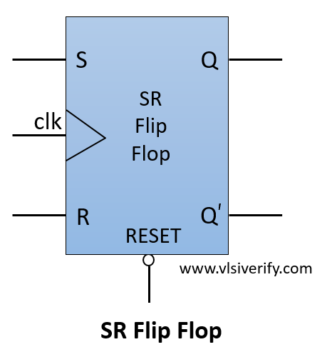
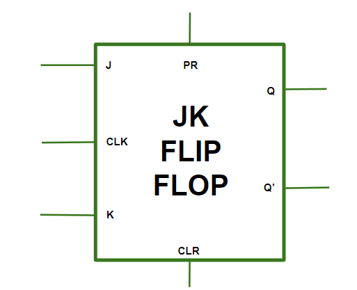
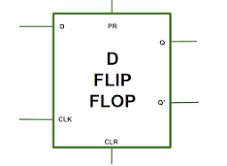
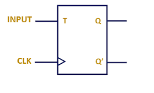

> ```md
> # Four Basic types flip-flops
> ```
> 1. SR Flip-Flop — Set and Reset
> 2. JK Flip-Flop — Set, Reset, and Toggle
> 3. D Flip-Flop — Data or Delay
> 4. T Flip-Flop — Toggle

**-----------------------------------------------------------------------------------------------**


> ```md
> ## Characteristic table
> ```
> - Q(t) = current state, before the update  
> - S / J = set, tells circuit to turn on  
> - R / K = reset, tells circuit to turn off  
> - Q(t+1) = after change, after the update
> - 0 = OFF  
> - 1 = ON

**-----------------------------------------------------------------------------------------------**

> ```md
> ### SR Operation / Criteria Table
> ```
> | S | R | Operation |
> |:---:|:---:|---|
> | 0 | 0 | Hold — keep the current state |
> | 0 | 1 | Reset — set output to 0 |
> | 1 | 0 | Set — set output to 1 |
> | 1 | 1 | Invalid — forbidden state |
> ```md
> ### SR flip-flop Characteristic / Truth Table
> ```
> | Q(t) | S | R | Q(t+1) | explanation |
> |:---:|:---:|:---:|:---:|---|
> | 0 | 0 | 0 | 0 (no change) | current state is off, did not turn on or off, so after change is same/ no change |
> | 0 | 0 | 1 | 0 | current state is off, reset the circuit to be off, ultimately it will be off |
> | 0 | 1 | 0 | 1 | current state is off, set the curcuit to turn on, result is circuit turns on |
> | 0 | 1 | 1 | (Invalid) | current state is off, set the circuit to turn off and on, invalid |
> | 1 | 0 | 0 | 1 (no change) | current state is on, did not turn on or off, so after change is same/ no change |
> | 1 | 0 | 1 | 0 | current state is on, reset the circuit to be off, circuit was on, it will be off |
> | 1 | 1 | 0 | 1 | current state is on, set the curcuit to turn on, circuit was already on, will be on |
> | 1 | 1 | 1 | (Invalid) | current state is on, set the circuit to turn off and on, invalid |
> ```md
> ### SR flip-flop Excitation Table
>```
> | Present state (Q) | Desired next state (Q+) | Required J | Required K |
> |:---:|:---:|:---:|:---:|
> | 0 | 0 | 0 | X |
> | 0 | 1 | 1 | 0 |
> | 1 | 0 | 0 | 1 |
> | 1 | 1 | X | 0 |
>  - Here, X means “don't care” — either 0 or 1 will work.  
>```md
> #### How standard SR excitation table came
> ```
> - Q / Q(t) = Before change
> - Q+ / Q(t+1) = After change
> - Match the Q and Q+ with SR flip-flop operation table before and after, Q(t) and Q(t+1).
> 
> | Q | Q+ | Possible SR combinations | Simplified S | Simplified R |
> |:---:|:---:|---|:---:|:---:|
> | 0 | 0 | 00, 01 | 0 | X |
> | 0 | 1 | 10 | 1 | 0 |
> | 1 | 0 | 01 | 0 | 1 |
> | 1 | 1 | 00, 10 | X | 0 |
> ---
> - SR flip flop diagram


**-----------------------------------------------------------------------------------------------**

> ```md
> ### JK Operation / Criteria Table
> ```
> | J | K | Operation |
> |:---:|:---:|---|
> | 0 | 0 | Hold — keep the current state |
> | 0 | 1 | Reset — set output to 0 |
> | 1 | 0 | Set — set output to 1 |
> | 1 | 1 | Toggle — change to the opposite state |
> 
> ```md
> # JK flip-flop Characteristic / Truth Table
> ```
> > - match J, K inputs with JK operation table
> 
> | Q(t) | J | K | Q(t+1) | explanation |
> |:---:|:---:|:---:|:---:|---|
> | 0 | 0 | 0 | 0 (no change) | current state is off, Hold operation, so no change |
> | 0 | 0 | 1 | 0 | current state is off, reset operation, output is 0 |
> | 0 | 1 | 0 | 1 | current state is off, Set operation, output is 1 |
> | 0 | 1 | 1 | 1(opposite) | current state is off, Toggle operation, output is 1 |
> | 1 | 0 | 0 | 1 (no change) | current state is on, Hold operation, so no change |
> | 1 | 0 | 1 | 0 | current state is on, reset operation, output is 0 |
> | 1 | 1 | 0 | 1 | current state is on, Set operation, output is 1 |
> | 1 | 1 | 1 | 0(opposite) | current state is on, Toggle operation, output is 0 |
> 
> ```md
> ### JK flip-flop excitation table
> ```
> | Present state (Q) | Desired next state (Q+) | Required J | Required K |
> |:---:|:---:|:---:|:---:|
> | 0 | 0 | 0 | X |
> | 0 | 1 | 1 | X |
> | 1 | 0 | X | 1 |
> | 1 | 1 | X | 0 |
> ```md
> ### How standard JK exirement table came
> ```
> > - Q / Q(t) = Before change
> > - Q+ / Q(t+1)= After change
> > - match the Q and Q+ with JK flip-flops table before and after, Q(t) and Q(t+1) 
> 
> | Q | Q+ | Possible JK combinations | Simplified J | Simplified K |
> |:---:|:---:|---|:---:|:---:|
> | 0 | 0 | 00, 01 | 0 | X |
> | 0 | 1 | 10, 11 | 1 | X |
> | 1 | 0 | 01, 11 | X | 1 |
> | 1 | 1 | 00, 10 | X | 0 |
> 
> - Here, X means “don't care” — either 0 or 1 will work.  
> - For excitement table, the inputs and output will be given, need to find out the values of flip-flop inputs to reach the output from the inputs
> ---
> - JK flip flop diagram


**-----------------------------------------------------------------------------------------------**

> #### Difference between JK and SR
> 
> > S=1,R=1, forbidden condition, outputs invalid  
> > J=1,K=1, produces toggle, output is opposite of input

**-----------------------------------------------------------------------------------------------**

> ```md
> ### D Operation / Criteria Table
> ```
> | D | Operation |
> |:---:|---|
> | 0 | Reset — set output to 0 |
> | 1 | Set — set output to 1 |
> 
> ```md
> ### D flip-flop Characteristic / Truth Table
> ```
> > - Match D input with the D operation table.
> 
> | Q(t) | D | Q(t+1) | explanation |
> |:---:|:---:|:---:|---|
> | 0 | 0 | 0 | Current state is off, D = 0, so output remains 0 |
> | 0 | 1 | 1 | Current state is off, D = 1, so output becomes 1 |
> | 1 | 0 | 0 | Current state is on, D = 0, so output becomes 0 |
> | 1 | 1 | 1 | Current state is on, D = 1, so output remains 1 |
> 
> ```md
> ### D flip-flop Excitation Table
> ```
> | Present state (Q) | Desired next state (Q+) | Required D |
> |:---:|:---:|:---:|
> | 0 | 0 | 0 |
> | 0 | 1 | 1 |
> | 1 | 0 | 0 |
> | 1 | 1 | 1 |
> 
> ```md
> ### How standard D excitation table came
> ```
> > - Q / Q(t) = Before change
> > - Q+ / Q(t+1) = After change
> > - Match the Q and Q+ with the D flip-flop characteristic table before and after, Q(t) and Q(t+1).
> 
> | Q | Q+ | Possible D combinations | Simplified D |
> |:---:|:---:|:---:|:---:|
> | 0 | 0 | 0 | 0 |
> | 0 | 1 | 1 | 1 |
> | 1 | 0 | 0 | 0 |
> | 1 | 1 | 1 | 1 |
> 
> > - D must always equal the desired next state.
> > - For excitation table, the inputs and output will be given; need to find out the value of the flip-flop input to reach the desired output from the present state.
> 
> 
> - D flip flop diagram
>
> 

**-----------------------------------------------------------------------------------------------**

> ```md
> ### T Operation / Criteria Table
> ```
> | T | Operation |
> |:---:|---|
> | 0 | Hold — keep the current state |
> | 1 | Toggle — change to the opposite state |
> 
> ```md
> ### T flip-flop Characteristic / Truth Table
> ```
> > - Match T input with the T operation table.
> 
> | Q(t) | T | Q(t+1) | explanation |
> |:---:|:---:|:---:|---|
> | 0 | 0 | 0 (no change) | Current state is off, Hold operation, so no change |
> | 0 | 1 | 1 (opposite) | Current state is off, Toggle operation, so output becomes 1 |
> | 1 | 0 | 1 (no change) | Current state is on, Hold operation, so no change |
> | 1 | 1 | 0 (opposite) | Current state is on, Toggle operation, so output becomes 0 |
> 
> ```md
> ### T flip-flop Excitation Table
> ```
> | Present state (Q) | Desired next state (Q+) | Required T |
> |:---:|:---:|:---:|
> | 0 | 0 | 0 |
> | 0 | 1 | 1 |
> | 1 | 0 | 1 |
> | 1 | 1 | 0 |
> 
> ```md
> ### How standard T excitation table came
> ```
> > - Q / Q(t) = Before change
> > - Q+ / Q(t+1) = After change
> > - Match the Q and Q+ with the T flip-flop characteristic table before and after, Q(t) and Q(t+1).
> 
> | Q | Q+ | Possible T combinations | Simplified T |
> |:---:|:---:|:---:|:---:|
> | 0 | 0 | 0 | 0 |
> | 0 | 1 | 1 | 1 |
> | 1 | 0 | 1 | 1 |
> | 1 | 1 | 0 | 0 |
> 
> > - Here, T = 0 means Hold and T = 1 means Toggle.
> > - For excitation table, the inputs and output will be given; need to find out the value of the flip-flop input to reach the desired output from the present state.
> 
> - T flip flop diagram
> 
> 


**-----------------------------------------------------------------------------------------------**
