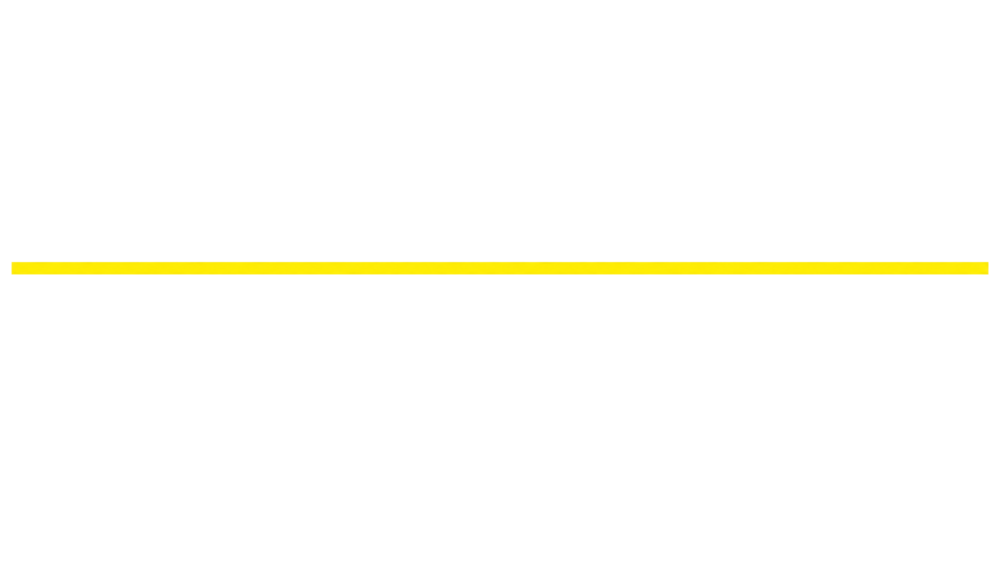
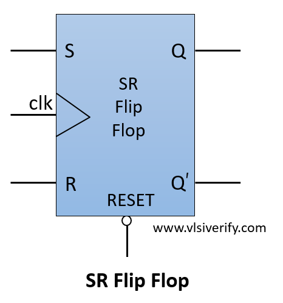
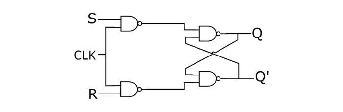
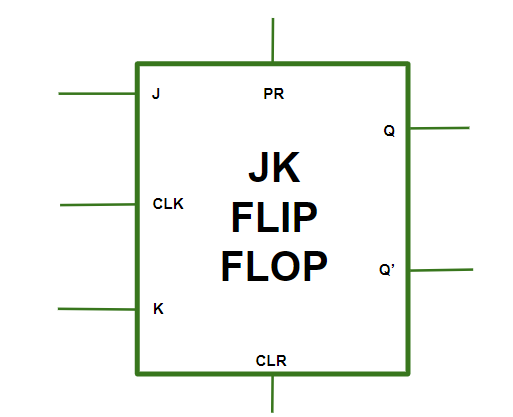
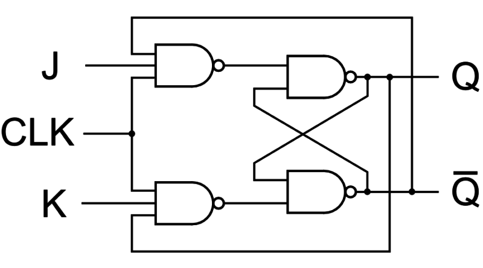
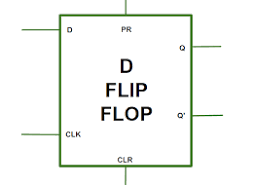
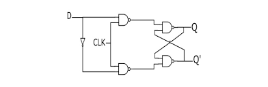
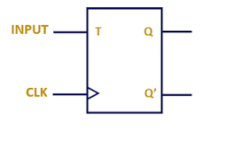
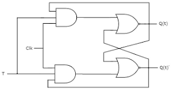

> ```md
> # Four Basic types flip-flops
> ```
>
> 1. SR Flip-Flop — Set and Reset
> 2. JK Flip-Flop — Set, Reset, and Toggle
> 3. D Flip-Flop — Data or Delay
> 4. T Flip-Flop — Toggle
>


> [!TIP]  
> Flip-Flops are our operations  
> States are the bulbs operation


> ```md
> # We will learn
> ```
>
> 1. Operation / Criteria Table (Rules for each flip-flop)
> 2. Characteristic Table (Full Version)
> 3. Excitation Table (X Version)
> 4. Circuit & Logical diagram
> 5. Characteristic equation : A characteristic equation is a Boolean expression that describes the relationship between the inputs, present state, and next state of a flip-flop.

> ```md
> # Keywords
> ```
>
> - Q(t) = current state, before the update
> - S / J = set, tells circuit to turn on
> - R / K = reset, tells circuit to turn off
> - Q(t+1) = after change, after the update
> - 0 = OFF
> - 1 = ON




# SR Flip-Flop

### SR Operation / Criteria Table

| S | R | Operation |
|:---:|:---:|---|
| 0 | 0 | Hold/ no change — keep the current state |
| 0 | 1 | Reset — set output to 0 |
| 1 | 0 | Set — set output to 1 |
| 1 | 1 | Invalid — forbidden state |

### SR flip-flop Characteristic / Truth Table

> - match SR opeations with SR operation table

| Q(t) |  S  |  R  |    Q(t+1)     | explanation                                                                         |
| :--: | :-: | :-: | :-----------: | ----------------------------------------------------------------------------------- |
|  0   |  0  |  0  | 0 (no change) | current state is off, did not turn on or off, so after change is same/ no change    |
|  0   |  0  |  1  |       0       | current state is off, reset the circuit to be off, ultimately it will be off        |
|  0   |  1  |  0  |       1       | current state is off, set the curcuit to turn on, result is circuit turns on        |
|  0   |  1  |  1  |   (Invalid)   | current state is off, set the circuit to turn off and on, invalid                   |
|  1   |  0  |  0  | 1 (no change) | current state is on, did not turn on or off, so after change is same/ no change     |
|  1   |  0  |  1  |       0       | current state is on, reset the circuit to be off, circuit was on, it will be off    |
|  1   |  1  |  0  |       1       | current state is on, set the curcuit to turn on, circuit was already on, will be on |
|  1   |  1  |  1  |   (Invalid)   | current state is on, set the circuit to turn off and on, invalid                    |

### SR flip-flop Excitation Table

| Present state Q(t) | Next state Q(t+1) | Required S | Required R |
| :---------------: | :-------------: | :--------: | :--------: |
|         0         |        0        |     0      |     X      |
|         0         |        1        |     1      |     0      |
|         1         |        0        |     0      |     1      |
|         1         |        1        |     X      |     0      |

### Characteristic Equation
$ Q(t+1) = S + R' Q$

> [!NOTE]  
> Here, X means “don't care” — either 0 or 1 will work.


### How standard SR excitation table came

> - Q(t) = Before change
> - Q(t+1) = After change
> - Match the Q and Q(t+1) with SR flip-flop operation table before and after, Q(t) and Q(t+1).

 |  Q(t)  | Q(t+1)  | Possible SR combinations | Simplified S | Simplified R |
 | :-: | :-: | ------------------------ | :----------: | :----------: |
 |  0  |  0  | 00, 01                   |      0       |      X       |
 |  0  |  1  | 10                       |      1       |      0       |
 |  1  |  0  | 01                       |      0       |      1       |
 |  1  |  1  | 00, 10                   |      X       |      0       |


### SR flip flop circuit diagram


### SR flip flop logical diagram



# JK

### JK Operation / Criteria Table

 | J | K | Operation |
 |:---:|:---:|---|
 | 0 | 0 | Hold/ no change — keep the current state |
 | 0 | 1 | Reset — set output to 0 |
 | 1 | 0 | Set — set output to 1 |
 | 1 | 1 | Toggle — change to the opposite state |
>

### JK flip-flop Characteristic / Truth Table

 > - match J, K operations with JK operation table

 | Q(t) |  J  |  K  |    Q(t+1)     | explanation                                         |
 | :--: | :-: | :-: | :-----------: | --------------------------------------------------- |
 |  0   |  0  |  0  | 0 (no change) | current state is off, Hold operation, so no change  |
 |  0   |  0  |  1  |       0       | current state is off, reset operation, output is 0  |
 |  0   |  1  |  0  |       1       | current state is off, Set operation, output is 1    |
 |  0   |  1  |  1  |  1(opposite)  | current state is off, Toggle operation, output is 1 |
 |  1   |  0  |  0  | 1 (no change) | current state is on, Hold operation, so no change   |
 |  1   |  0  |  1  |       0       | current state is on, reset operation, output is 0   |
 |  1   |  1  |  0  |       1       | current state is on, Set operation, output is 1     |
 |  1   |  1  |  1  |  0(opposite)  | current state is on, Toggle operation, output is 0  |


### JK flip-flop excitation table

 | Present state Q(t) | Next state Q(t+1) | Required J | Required K |
 | :---------------: | :-------------: | :--------: | :--------: |
 |         0         |        0        |     0      |     X      |
 |         0         |        1        |     1      |     X      |
 |         1         |        0        |     X      |     1      |
 |         1         |        1        |     X      |     0      |

### Characteristic Equation
$Q(t+1) = J \cdot Q' + J' \cdot Q $

### How standard JK excitation table came

> - Q(t) = Before change
> - Q(t+1)= After change
> - match the Q(t) and Q(t+1) with JK flip-flops table before and after, Q(t) and Q(t+1)
>
 |  Q(t)  | Q(t+1)  | Possible JK combinations | Simplified J | Simplified K |
 | :-: | :-: | ------------------------ | :----------: | :----------: |
 |  0  |  0  | 00, 01                   |      0       |      X       |
 |  0  |  1  | 10, 11                   |      1       |      X       |
 |  1  |  0  | 01, 11                   |      X       |      1       |
 |  1  |  1  | 00, 10                   |      X       |      0       |

> [!NOTE]
> Here, X means “don't care” — either 0 or 1 will work.


### JK flip flop circuit diagram


### JK flip flop logical diagram


> ### Difference between JK and SR
>
> S=1,R=1, forbidden condition, outputs invalid  
> J=1,K=1, produces toggle, output is opposite of input


# D Flip-Flop

### D Operation / Criteria Table

 |  D  | Operation               |
 | :-: | ----------------------- |
 |  0  | Reset — set output to 0 |
 |  1  | Set — set output to 1   |


### D flip-flop Characteristic / Truth Table

> - Match D input with the D operation table.

 | Q(t) |  D  | Q(t+1) | explanation                                      |
 | :--: | :-: | :----: | ------------------------------------------------ |
 |  0   |  0  |   0    | Current state is off, D = 0, so output remains 0 |
 |  0   |  1  |   1    | Current state is off, D = 1, so output becomes 1 |
 |  1   |  0  |   0    | Current state is on, D = 0, so output becomes 0  |
 |  1   |  1  |   1    | Current state is on, D = 1, so output remains 1  |

### D flip-flop Excitation Table

 | Present state Q(t) | Next state Q(t+1) | Required D |
 | :---------------: | :-------------: | :--------: |
 |         0         |        0        |     0      |
 |         0         |        1        |     1      |
 |         1         |        0        |     0      |
 |         1         |        1        |     1      |

### How standard D excitation table came

> - Q(t) = Before change
> - Q(t+1) = After change
> - Match the Q and Q(t+1) with the D flip-flop characteristic table before and after, Q(t) and Q(t+1).

 |  Q(t)  | Q(t+1)  | Possible D combinations | Simplified D |
 | :-: | :-: | :---------------------: | :----------: |
 |  0  |  0  |            0            |      0       |
 |  0  |  1  |            1            |      1       |
 |  1  |  0  |            0            |      0       |
 |  1  |  1  |            1            |      1       |

### Characteristic Equation
$Q(t+1) = D$ 

> [!NOTE]
> D is always equal to the next state.

### D flip flop circuit diagram


### D flip flop logical diagram



# T Flip-Flop

### T Operation / Criteria Table

 |  T  | Operation                                |
 | :-: | ---------------------------------------- |
 |  0  | Hold/ no change — keep the current state |
 |  1  | Toggle — change to the opposite state    |

### T flip-flop Characteristic / Truth Table

> - Match T input with the T operation table.

 | Q(t) |  T  |    Q(t+1)     | explanation                                                 |
 | :--: | :-: | :-----------: | ----------------------------------------------------------- |
 |  0   |  0  | 0 (no change) | Current state is off, Hold operation, so no change          |
 |  0   |  1  | 1 (opposite)  | Current state is off, Toggle operation, so output becomes 1 |
 |  1   |  0  | 1 (no change) | Current state is on, Hold operation, so no change           |
 |  1   |  1  | 0 (opposite)  | Current state is on, Toggle operation, so output becomes 0  |

### T flip-flop Excitation Table
| Present state Q(t) | Next state Q(t+1) | Required T |
| :---------------: | :-------------: | :--------: |
|         0         |        0        |     0      |
|         0         |        1        |     1      |
|         1         |        0        |     1      |
|         1         |        1        |     0      |

### Characteristic Equation
$ Q(t+1) = T' \cdot Q + T \cdot Q'$\
$ Q(t+1) = T \oplus Q$

### How standard T excitation table came

> - Q / Q(t) = Before change
> - Q(t+1) / Q(t+1) = After change
> - Match the Q and Q(t+1) with the T flip-flop characteristic table before and after, Q(t) and Q(t+1).

 |  Q(t)  | Q(t+1)  | Possible T combinations | Simplified T |
 | :-: | :-: | :---------------------: | :----------: |
 |  0  |  0  |            0            |      0       |
 |  0  |  1  |            1            |      1       |
 |  1  |  0  |            1            |      1       |
 |  1  |  1  |            0            |      0       |

### T flip flop circuit diagram


### T flip flop logical diagram



# Conversion from one flip flop to another

### JK to D

> Show Characteristic equations of both

> make the table using Present state and inputs, find next state and next flip-flop operation

| D	| Q(t)	|Q(t+1)	|J	|K|
|:-:|:-:|:-:|:-:|:-:|
| 0	|0|	0|	0	|X |
| 0	|1|	0|	X	|1 |
| 1	|0|	1|	1	|X |
| 1	|1|	1|	X	|0 |

Kmap for J and K using inputs D and Q:  
$J =D, K = D'$

### D to JK

> Show Characteristic equations of both

> make the table using Present state and inputs, find next state and next flip-flop operation

|J|	K|	Q(t) 	|Q(t+1)	|D|
|:-:|:-:|:-:|:-:|:-:|
|0|	0|	0|	0	|0|
|0|	0|	1|	1	|1|
|0|	1|	0|	0	|0|
|0|	1|	1|	0	|0|
|1|	0|	0|	1	|1|
|1|	0|	1|	1	|1|
|1|	1|	0|	1	|1|
|1|	1|	1|	0	|0|

Kmap for D using inputs J, K and Q(t):  
$ D= J \cdot Q(t)' + K' \cdot Q(t)$