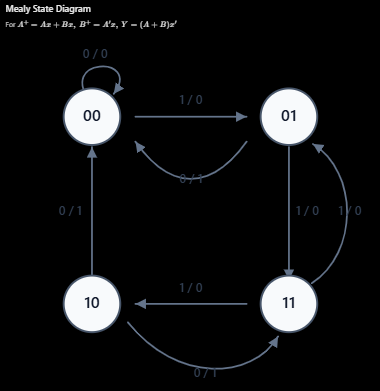

```md
## Sequential circuit/logic
```
> - A digital logic circuit whose output depends on both the current inputs and previous outputs.  
> - It can remember what happened before.  
> - Uses memory element to remember, latch or flip-flop

**-----------------------------------------------------------------------------------------------**

```md
## Characteristic table
```
> - Q(t) = current state, before the update  
> - S = set, tells circuit to turn on  
> - R = reset, tells circuit to turn off  
> - Q(t+1) = after change, after the update
> - 0 = OFF  
> - 1 = ON


```md
### SR flip-flop
```
| Q(t) | S | R | Q(t+1) | explanation |
|:---:|:---:|:---:|:---:|---|
| 0 | 0 | 0 | 0 (no change) | current state is off, did not turn on or off, so after change is same/ no change |
| 0 | 0 | 1 | 0 | current state is off, reset the circuit to be off, ultimately it will be off |
| 0 | 1 | 0 | 1 | current state is off, set the curcuit to turn on, result is circuit turns on |
| 0 | 1 | 1 | (Invalid) | current state is off, set the circuit to turn off and on, invalid |
| 1 | 0 | 0 | 1 (no change) | current state is on, did not turn on or off, so after change is same/ no change |
| 1 | 0 | 1 | 0 | current state is on, reset the circuit to be off, circuit was on, it will be off |
| 1 | 1 | 0 | 1 | current state is on, set the curcuit to turn on, circuit was already on, will be on |
| 1 | 1 | 1 | (Invalid) | current state is on, set the circuit to turn off and on, invalid |

**-----------------------------------------------------------------------------------------------**

```md
### JK Operation / Criteria Table
```
| J | K | Operation |
|:---:|:---:|---|
| 0 | 0 | Hold — keep the current state |
| 0 | 1 | Reset — set output to 0 |
| 1 | 0 | Set — set output to 1 |
| 1 | 1 | Toggle — change to the opposite state |

```md
### JK flip-flop
```
> - match J, K inputs with JK operation table

| Q(t) | J | K | Q(t+1) | explanation |
|:---:|:---:|:---:|:---:|---|
| 0 | 0 | 0 | 0 (no change) | current state is off, Hold operation, so no change |
| 0 | 0 | 1 | 0 | current state is off, reset operation, output is 0 |
| 0 | 1 | 0 | 1 | current state is off, Set operation, output is 1 |
| 0 | 1 | 1 | 1 | current state is off, Toggle operation, output is 1 |
| 1 | 0 | 0 | 1 (no change) | current state is on, Hold operation, so no change |
| 1 | 0 | 1 | 0 | current state is on, reset operation, output is 0 |
| 1 | 1 | 0 | 1 | current state is on, Set operation, output is 1 |
| 1 | 1 | 1 | 0 | current state is on, Toggle operation, output is 0 |

#### Difference between JK and SR

> S=1,R=1, forbidden condition, outputs invalid  
> J=1,K=1, produces toggle, output is opposite of input
```md
### Standard JK excitement table
```
| Present state (Q) | Desired next state (Q+) | Required J | Required K |
|:---:|:---:|:---:|:---:|
| 0 | 0 | 0 | X |
| 0 | 1 | 1 | X |
| 1 | 0 | X | 1 |
| 1 | 1 | X | 0 |

### How standard JK exirement table came

> - Q / Q(t) = Before change
> - Q+ / Q(t+1)= After change
> - match the Q and Q+ with JK flip-flops table before and after, Q(t) and Q(t+1) 

| Q | Q+ | Possible JK combinations | Simplified J | Simplified K |
|:---:|:---:|---|:---:|:---:|
| 0 | 0 | 00, 01 | 0 | X |
| 0 | 1 | 10, 11 | 1 | X |
| 1 | 0 | 01, 11 | X | 1 |
| 1 | 1 | 00, 10 | X | 0 |

> - Here, X means “don't care” — either 0 or 1 will work.  
> - For excitement table, the inputs and output will be given, need to find out the values of flip-flop inputs to reach the output from the inputs

**-----------------------------------------------------------------------------------------------**
```md
### State table
```
> - A state table shows how a sequential circuit moves from its current state to its next state for each possible input.  
> - The key difference is that a state table describes the behavior of the whole sequential circuit, while a characteristic table describes how an individual flip-flop behaves.

| Present State A | Present State B | Input X | Next state A+ | Next state B+ | Output Y |
|:---:|:---:|:---:|:---:|:---:|:---:|
| 0 | 0 | 0 |  |  |  |
| 0 | 0 | 1 |  |  |  |
| 0 | 1 | 0 |  |  |  |
| 0 | 1 | 1 |  |  |  |
| 1 | 0 | 0 |  |  |  |
| 1 | 0 | 1 |  |  |  |
| 1 | 1 | 0 |  |  |  |
| 1 | 1 | 1 |  |  |  |

> - We can't fill in A+, B+, and Y yet without knowing the circuit's logic or its equations. Different circuits can have different next states and outputs for the same present state and input.

**-----------------------------------------------------------------------------------------------**

```md
### Finding JK excitement table from equations
```
> - inputs : **A+ = A . x + B . x**  
> - inputs : **B+ = A' . x**  
> - output : **Y = (A+B) . x'**

> calculate A+ and B+ for each combination of \(A,B,x\), then use these rules separately for flip-flops \(A\) and \(B\). There are \(2^3=8\) combinations because \(A\), \(B\), and \(x\) are binary variables.

| Present A | Present B | Input x | Next A+ | Next B+ | Output Y | JA | KA | JB | KB |
|:---:|:---:|:---:|:---:|:---:|:---:|:---:|:---:|:---:|:---:|
| 0 | 0 | 0 | 0 | 0 | 0 | 0 | X | 0 | X |
| 0 | 0 | 1 | 0 | 1 | 0 | 0 | X | 1 | X |
| 0 | 1 | 0 | 0 | 0 | 1 | 0 | X | X | 1 |
| 0 | 1 | 1 | 1 | 1 | 0 | 1 | X | X | 0 |
| 1 | 0 | 0 | 0 | 0 | 1 | X | 1 | 0 | X |
| 1 | 0 | 1 | 1 | 0 | 0 | X | 0 | 0 | X |
| 1 | 1 | 0 | 0 | 0 | 1 | X | 1 | X | 1 |
| 1 | 1 | 1 | 1 | 0 | 0 | X | 0 | X | 1 |

> - used AND OR NOT

**-----------------------------------------------------------------------------------------------**


```md
### Finding state table from equations
```
> **A+ = A . x + B . x**, input  
> **B+ = A' . x**, input  
> **Y = (A+B) . x'**, output

| Present A | Present B | Input x | Next A+ | Next B+ | Output Y |
|:---:|:---:|:---:|:---:|:---:|:---:|
| 0 | 0 | 0 | 0 | 0 | 0 |
| 0 | 0 | 1 | 0 | 1 | 0 |
| 0 | 1 | 0 | 0 | 0 | 1 |
| 0 | 1 | 1 | 1 | 1 | 0 |
| 1 | 0 | 0 | 0 | 0 | 1 |
| 1 | 0 | 1 | 1 | 0 | 0 |
| 1 | 1 | 0 | 0 | 0 | 1 |
| 1 | 1 | 1 | 1 | 0 | 0 |

**-----------------------------------------------------------------------------------------------**

```md
### State diagram
```
> A state diagram is a visual representation of your state table. Each circle represents a state (A,B), and each arrow shows what happens when input x is 0 or 1.

using previous equation and state table

> **A+ = A . x + B . x**, input  
> **B+ = A' . x**, input  
> **Y = (A+B) . x'**, output

> Because you have two state bits, \(A\) and \(B\), there are \(2^2=4\) states:


**2. Get the arrows from your state table using previous state table**

| Current state AB | Input x | Next state A+B+ | Output Y | Arrow label |
|:---:|:---:|:---:|:---:|:---:|
| 00 | 0 | 00 | 0 | 0/0 |
| 00 | 1 | 01 | 0 | 1/0 |
| 01 | 0 | 00 | 1 | 0/1 |
| 01 | 1 | 11 | 0 | 1/0 |
| 10 | 0 | 00 | 1 | 0/1 |
| 10 | 1 | 10 | 0 | 1/0 |
| 11 | 0 | 00 | 1 | 0/1 |
| 11 | 1 | 10 | 0 | 1/0 |



**-----------------------------------------------------------------------------------------------**

**### Mealy and Moore state diagrams**

> **Mealy machine:** The output depends on the present state and current input. The output is usually written on each arrow as `input/output`.

> **Moore machine:** The output depends only on the present state. The output is written inside or beside each state circle, and arrows are labeled with the input.

**Example of a Mealy machine**

| Present state | Input x | Next state | Output Y |
|:---:|:---:|:---:|:---:|
| S0 | 0 | S0 | 0 |
| S0 | 1 | S1 | 1 |
| S1 | 0 | S0 | 0 |
| S1 | 1 | S1 | 1 |

Arrow labels: \(S_0 \xrightarrow{0/0} S_0\), \(S_0 \xrightarrow{1/1} S_1\), \(S_1 \xrightarrow{0/0} S_0\), \(S_1 \xrightarrow{1/1} S_1\).

**Example of a Moore machine**

| Present state | Output Y | Input x | Next state |
|:---:|:---:|:---:|:---:|
| S0 | 0 | 0 | S0 |
| S0 | 0 | 1 | S1 |
| S1 | 1 | 0 | S0 |
| S1 | 1 | 1 | S1 |

State outputs: \(S_0/Y=0\), \(S_1/Y=1\).

---

**### Examples**

The following three examples are additional practice examples. Each includes a circuit equation, a conceptual circuit diagram, a state table, and an excitation table.

**#### Example 1: Conditional toggle using one JK flip-flop**

Circuit equation:

\[
Q^+=Q\oplus x,\qquad Y=Q
\]

JK inputs: \(J=x,\ K=x\).

Circuit diagram:

```text
          +-----------+
x --------| J       Q |-----> Y = Q
x --------| K   JK    |
CLK ------| CLK       |
          +-----------+
```

State table:

| Present Q | Input x | Next Q+ | Output Y |
|:---:|:---:|:---:|:---:|
| 0 | 0 | 0 | 0 |
| 0 | 1 | 1 | 0 |
| 1 | 0 | 1 | 1 |
| 1 | 1 | 0 | 1 |

Excitation table:

| Present Q | Next Q+ | J | K |
|:---:|:---:|:---:|:---:|
| 0 | 0 | 0 | X |
| 0 | 1 | 1 | X |
| 1 | 1 | X | 0 |
| 1 | 0 | X | 1 |

**#### Example 2: Two-bit circuit using the equations above**

Circuit equations:

\[
A^+=Ax+Bx,\qquad B^+=A'x,\qquad Y=(A+B)x'
\]

Circuit diagram:

```text
 A, B, x ---> [combinational next-state logic]
                        | A+       | B+
                        v          v
                    [JK FF A]  [JK FF B]
                        | A        | B
                        +---- feedback to logic

 Output logic: Y = (A OR B) AND NOT x
```

State and excitation table:

| A | B | x | A+ | B+ | Y | JA | KA | JB | KB |
|:---:|:---:|:---:|:---:|:---:|:---:|:---:|:---:|:---:|:---:|
| 0 | 0 | 0 | 0 | 0 | 0 | 0 | X | 0 | X |
| 0 | 0 | 1 | 0 | 1 | 0 | 0 | X | 1 | X |
| 0 | 1 | 0 | 0 | 0 | 1 | 0 | X | X | 1 |
| 0 | 1 | 1 | 1 | 1 | 0 | 1 | X | X | 0 |
| 1 | 0 | 0 | 0 | 0 | 1 | X | 1 | 0 | X |
| 1 | 0 | 1 | 1 | 0 | 0 | X | 0 | 0 | X |
| 1 | 1 | 0 | 0 | 0 | 1 | X | 1 | X | 1 |
| 1 | 1 | 1 | 1 | 0 | 0 | X | 0 | X | 1 |

**#### Example 3: Two-bit synchronous modulo-4 up-counter**

Circuit equations:

\[
Q_0^+=Q_0',\qquad Q_1^+=Q_1\oplus Q_0
\]

JK inputs: \(J_0=K_0=1,\ J_1=K_1=Q_0\).

Circuit diagram:

```text
             +-----------+       +-----------+
CLK -------->| CLK   JK0 |       | CLK   JK1 |<---- CLK
1 ---------->| J0     Q0 |------>| J1        |
1 ---------->| K0        |  Q0   | K1     Q1 |
             +-----------+       +-----------+

J0 = K0 = 1
J1 = K1 = Q0
Both flip-flops share the same clock.
```

State table:

| Present Q1 | Present Q0 | Next Q1+ | Next Q0+ |
|:---:|:---:|:---:|:---:|
| 0 | 0 | 0 | 1 |
| 0 | 1 | 1 | 0 |
| 1 | 0 | 1 | 1 |
| 1 | 1 | 0 | 0 |

Excitation table:

| Q1 | Q0 | Q1+ | Q0+ | J1 | K1 | J0 | K0 |
|:---:|:---:|:---:|:---:|:---:|:---:|:---:|:---:|
| 0 | 0 | 0 | 1 | 0 | X | 1 | X |
| 0 | 1 | 1 | 0 | 1 | X | X | 1 |
| 1 | 0 | 1 | 1 | X | 0 | 1 | X |
| 1 | 1 | 0 | 0 | X | 1 | X | 1 |

---

